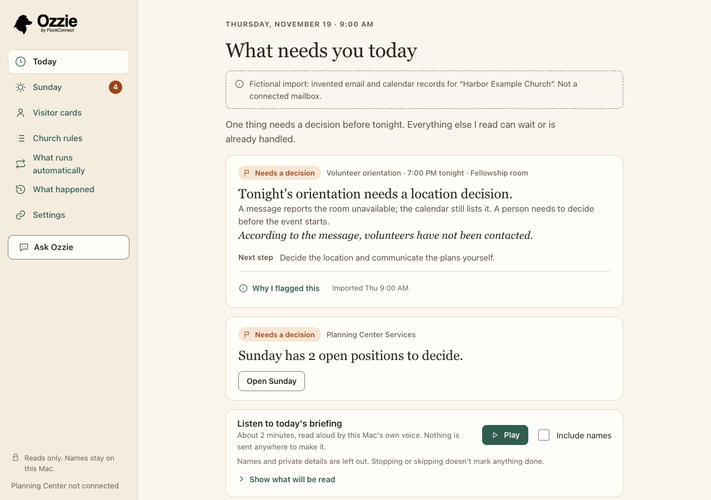

# Ozzie

[](https://github.com/tribett/ozzie/actions/workflows/ci.yml)

Ozzie by FlockConnect is a desktop app for church staff and ministry leaders.
It reads your church's Planning Center account, checks the coming Sunday
against rules you set, and lays out what needs a decision: a serving role
nobody has said yes to, a room booked twice, a follow-up with no one assigned.
It can draft a note for you to send yourself. People decide, and people go.

**Status:** early build from the AI for Church Hackathon 2026. It runs on
macOS on Apple Silicon. The app is not signed or notarized, so macOS will warn
you when you open it. Expect rough edges.

These screens show the app's built-in fictional example (invented church,
invented people). No church data is shown.




## What Ozzie does

- **Reads Planning Center, and only reads.** Ozzie makes a fixed list of GET
  requests (Services plans, positions and schedules; with your consent,
  Calendar room bookings, People workflow cards and Groups events). It never
  writes, edits or deletes anything in Planning Center. The list of reads is
  in [docs/build/sunday-capture-contract.md](docs/build/sunday-capture-contract.md).
  Signing in, renewing access and disconnecting use Planning Center's standard
  OAuth sign-in endpoints.
- **Shows facts with their source and check time.** Each finding says which of
  your church rules it relates to and what it checked. Anything Ozzie is unsure
  about is labelled "Worth a look".
- **Drafts, never sends.** Notes are drafts you copy into your own email or
  phone.
- **Keeps a record of what happened**, including checks that could not finish.
- **Works without a connection.** "See the fictional example" shows the app
  with an invented church.

## What Ozzie never does

The full list is in [docs/handoff/NEVER-LIST.md](docs/handoff/NEVER-LIST.md)
(written when the project was called TableWork). In short, Ozzie never:

- sends a message to a church member;
- writes a sermon, devotional or pastoral teaching;
- pretends to give pastoral care, counselling or prayer;
- scores, ranks or labels a person's spiritual health, faithfulness or risk;
- makes a pastoral decision or acts without a named person approving it;
- writes to Planning Center;
- sends the names it read from Planning Center to an AI model;
- presents uncertainty as fact, or hides what it read and when.

These are not settings. No user, church or plan can switch them off.

## How names stay off AI models

AI is optional. Without it, every check and draft still works. With it, Ozzie
can reword a draft note or answer a question about the Sunday it checked.

- **Placeholders, not names.** A draft goes to the model in placeholder form,
  for example "Hi [Volunteer A], could you serve as [Role]?". The model only
  rewords text Ozzie wrote itself, never text you typed about a person, and
  real names are put back on your Mac after the reply comes back
  (`core/src/draft-request.ts`).
- **Questions use a fact sheet without names.** When you ask about a Sunday,
  the model sees short fact lines in which people are `[Person 1]`,
  `[Person 2]` and so on (`core/src/ask.ts`). A question that contains a name
  the app has shown is refused, and nothing is sent. Ozzie can only recognise
  names it has read, so it can't catch a nickname or a family member's name
  that Planning Center doesn't hold. Don't type other people's details into a
  question.
- **A second check in native code.** Before any request leaves the app, the
  Rust layer checks it against every name the app has shown in this session.
  If one appears, nothing is sent (`core/native-auth/src/name_guard.rs`). The
  TypeScript and Rust checks run the same test vectors
  (`core/test/ask-parity.json`).
- **Names stay on your Mac.** Names read from Planning Center are used for
  display. A saved check (shown, with its original time, when Planning Center
  can't be reached) keeps the names it showed, in a file only your user
  account can read.

## Build and run

Requirements:

- macOS 13 or later on Apple Silicon, with the Xcode Command Line Tools
- Node.js 22.19 or later (`.node-version` names the version we test with)
- pnpm 10
- Rust 1.99.1 through rustup (`rustup toolchain install 1.99.1`); the crates
  pin it in `rust-toolchain.toml`

```sh
pnpm install --frozen-lockfile
pnpm typecheck                # TypeScript type check
pnpm test                     # TypeScript tests (core and app)
pnpm test:native              # Rust tests for core/native-auth
pnpm build:desktop            # unsigned app bundle
pnpm dev                      # browser walkthrough with invented data
```

`pnpm build:desktop` writes
`product/desktop/src-tauri/target/release/bundle/macos/Ozzie.app`. The app is
not signed or notarized. A copy you build yourself opens normally; a copy
downloaded from elsewhere is blocked by macOS until you allow it under System
Settings, Privacy & Security.

### Connect Planning Center

1. In Planning Center's developer settings, register a public OAuth
   application (Ozzie signs in with PKCE and holds no client secret) with the
   redirect URI `http://127.0.0.1:42819/oauth/callback`.
2. In Ozzie, open **Settings** and enter the application ID and your
   organization ID, then choose **Connect Planning Center**. Sign-in happens
   in your browser; the token is stored in your Mac's Keychain.
3. Choose the Sunday to check by service type and plan (or paste the plan's
   address).

Room bookings, follow-ups and group events are a separate opt-in. They ask
Planning Center for Calendar, People and Groups access, which Ozzie still uses
for reading only.

## Use your own AI key or a local model

Under **Settings**, choose one of:

- **A model on this Mac.** Ozzie talks to `http://127.0.0.1:11434/v1`, the
  default address of [Ollama](https://ollama.com), with the model `llama3.2`
  (run `ollama pull llama3.2` first). Requests stay on this Mac.
- **Your own AI provider.** Any OpenAI-compatible service over HTTPS. Enter its
  address and model name, then add your key to the Keychain yourself:

  ```sh
  security add-generic-password -U -s church.ozzie.model.v1 -a own-provider -w
  ```

  The `-w` flag with no value makes `security` ask for the key, so it does not
  end up in your shell history. The key never reaches the app's web view.

Whichever you choose, the same placeholder rules and native name check apply.

## Managed service

A separate, paid managed service for Ozzie provides a hosted AI route
that requires zero data retention on every request, along with accounts,
setup and support. The **Ozzie managed** choice in Settings uses that route
and needs a key from the service. Everything in this repository works without
it, and every safety check lives here, in the open code.

## Repository layout

- `core/` — shared logic with no user interface: Sunday coverage findings,
  operations findings (rooms, follow-ups, group events), the placeholder
  boundary, church time zones, and safety primitives (authorization broker,
  egress boundary, ledger). Tested with fixed, invented data.
- `core/native-auth/` — Rust crate: Planning Center OAuth, Keychain storage,
  the allowlisted read path, model routes and the native name check.
- `product/desktop/` — the Tauri desktop app (React web view plus Rust shell).
- `product/web/` — a browser walkthrough of the Sunday review with invented
  data.
- `product/src/`, `product/test/` — review logic shared by the apps, and its
  tests.
- `docs/` — the never-list, the Planning Center read contract, and decision
  records.

Planning Center data in tests and examples is invented. Some numeric IDs refer
to a Planning Center test organization that holds no real people.

## About this repository

This repository is published from a private development repository. Its
history starts at the first public release.

## License

Apache License 2.0. See [LICENSE](LICENSE) and [NOTICE](NOTICE).
