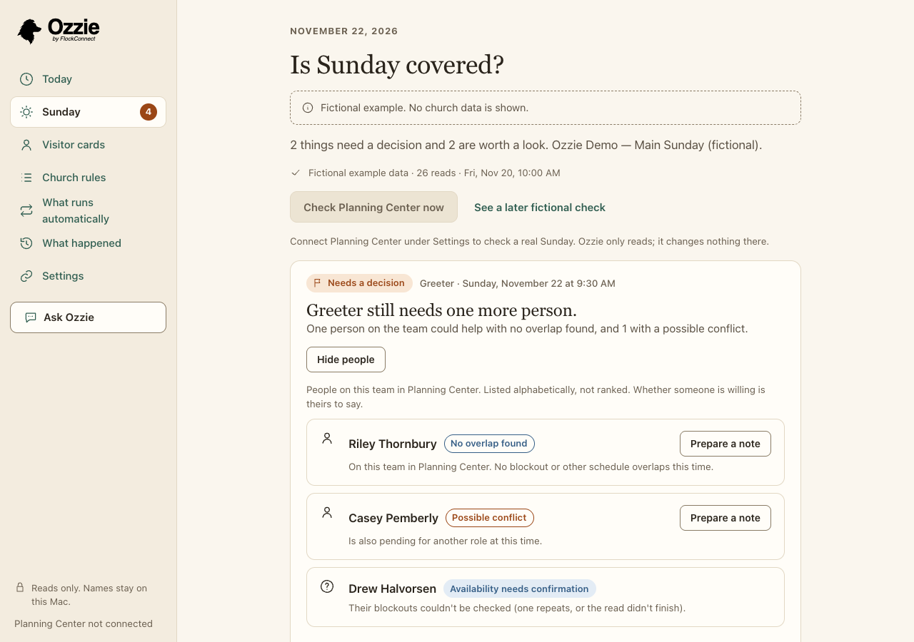
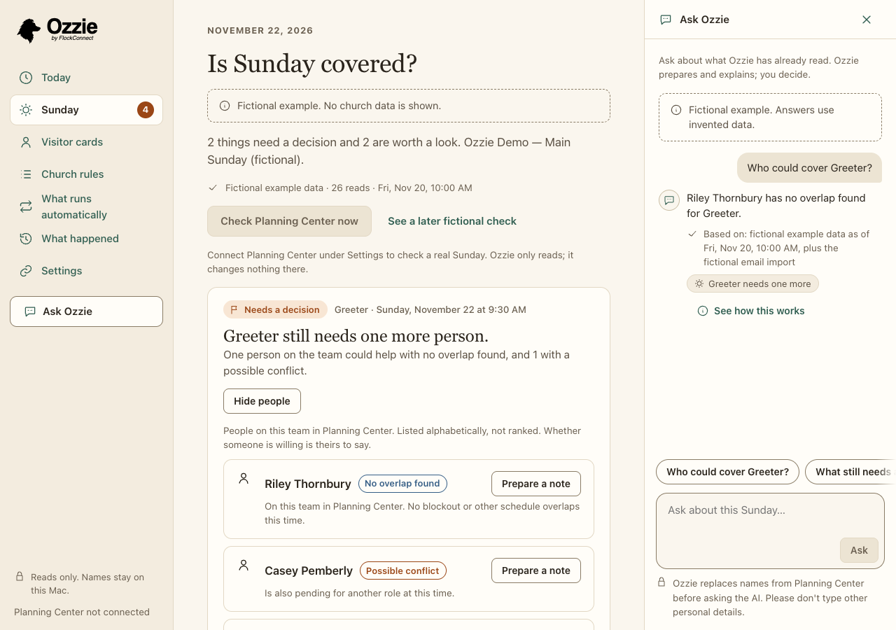

# Ozzie

[](https://github.com/tribett/ozzie/actions/workflows/ci.yml)

Ozzie by FlockConnect is a desktop app for church staff and ministry leaders.
It reads your church's Planning Center, B1 Church, Breeze or Genesis account,
checks your services against rules you set, and lays out what needs a decision: a serving role
nobody has said yes to and, with Planning Center, a room booked twice or a follow-up with
no one assigned.
It can draft a note for you to send yourself. People decide, and people go.

**Status:** early build from the AI for Church Hackathon 2026. It runs on
macOS on Apple Silicon. Builds you make from this repository are not signed or
notarized. Expect rough edges.

These screens show the app's built-in fictional example (invented church,
invented people). No church data is shown.






## What Ozzie does

- **Reads Planning Center, and changes it only when you confirm one change.**
  Ozzie makes a fixed list of GET
  requests (Services plans, positions and schedules, and the upcoming plans
  setup lists to choose from; with your consent, Calendar room bookings,
  People workflow cards, cleared People background checks for people
  scheduled on kids teams, and Groups events; each only if you turn it
  on, People forms, Check-Ins and Registrations, below; with People
  access, one person's email addresses or phone numbers when you open a note
  for them, below; and, when you ask to add someone to an open role, whether
  Planning Center lists that person as a child and as active and, for a team
  marked as a kids team, their background check status and end date (cleared
  and unfinished checks), below). It changes nothing in
  Planning Center unless your church turned on changes and you confirm one:
  adding one person who could help to an open role as unconfirmed, with the
  request waiting for you to send in Planning Center
  (`core/native-auth/src/change.rs`), and taking that person off again while
  the request is unsent. It never sends that request, never changes or removes
  anything else, and never changes anything on its own. The Services, Calendar,
  People and Groups reads are listed in
  [docs/build/sunday-capture-contract.md](docs/build/sunday-capture-contract.md);
  every read, these three and the two below included, is an operation in
  `core/native-auth/src/source.rs`. For a note's To line Ozzie reads only
  `/people/v2/people/{id}?include=emails&fields[Person]=child,emails&fields[Email]=address,primary,blocked`
  (Mail) or
  `/people/v2/people/{id}?include=phone_numbers&fields[Person]=child,phone_numbers&fields[PhoneNumber]=number,primary,location`
  (Messages), for that one person (`core/native-auth/src/contact.rs`).
  Signing in, renewing access and disconnecting use Planning Center's standard
  OAuth sign-in endpoints.
- **Or reads B1 Church or Breeze, and changes nothing there.** A church that plans its
  services in B1 Church or Breeze chooses it when Ozzie first opens, and gives
  Ozzie a key made in that system; the key goes only to that system and is
  kept in the Mac's Keychain. Ozzie reads the service it watches (roles, who is
  scheduled and how they answered, and in B1 Church each role's team and
  blockouts) from a fixed list of GET addresses per system
  (`core/church-systems/`), and says plainly what it can't see there (Breeze
  has no blockout dates and doesn't say how many people a role needs, so Ozzie
  shows who is on each role instead of calling the service covered; none of
  them shares background checks). Checks on a schedule, private notices, saved
  checks and Ask work with them as with Planning Center; jobs, Siri and
  Shortcuts, the copy for other AI apps and the extras below work with Planning
  Center only for now.
- **Or reads Genesis, and changes nothing there, with no coverage check.** Genesis shares
  no volunteer schedules, so Ozzie can't check whether a service is covered
  there and never says it is. A church on Genesis gives Ozzie a key with Read
  for Groups, Events and Forms only (no People: Ozzie reads no one's name from
  Genesis) and tells it the church's time zone, since Genesis gives event times
  without one. Ozzie then shows the events of the next four weeks, attendance
  for events that have ended, the groups, and how many times each form was
  filled in, says on Today when a form has been filled in again, reads Genesis
  when it opens and on the person's interval, and answers Ask on the Mac from
  what it read, with no AI. Genesis can also be read beside any of the other
  systems, for the same groups, events and forms.
- **People forms, Check-Ins and signups, if you turn them on.** Each is its
  own choice under Settings › Forms, check-ins and signups. For the People
  forms you choose to watch, Ozzie reads how many new submissions there are,
  when each was sent and whom it is for, never a form's answers; those names
  stay on your Mac like every other name Ozzie reads. Check-Ins and
  Registrations are read as counts only: how many checked in to each room at
  last Sunday's times (regular, guest and volunteer, as Planning Center counts
  them), and how many registered for each upcoming signup against its limit and
  when registration closes; never who checked in or who registered. These facts
  are shown on your Mac only: they aren't part of what Ask, AI help or other AI
  apps can see (`core/src/church-reads/`).
- **Shows facts with their source and check time.** Each finding says which of
  your church rules it relates to and what it checked. Anything Ozzie is unsure
  about is labelled "Worth a look".
- **Kids safety rules.** Mark which teams serve with kids in Church rules.
  Ozzie flags a kids team with fewer confirmed people at a service time than
  your rule asks for (it counts confirmed people; Services has no ages, so it
  never says "adults"), and anyone scheduled on a kids team without a current
  background check on file, or with one that expires before Sunday. A read
  that failed or was refused is listed as not checked, never as "no check".
- **Drafts, never sends.** A note is a draft you copy, or open unsent in your
  own email app or Messages, and send yourself. When you choose Open in Mail
  or Open in Messages on a note Ozzie prepared for one person, and Ozzie has
  People access, it reads that person's email addresses (for Mail) or phone
  numbers (for Messages) from Planning Center, and whether Planning Center
  lists them as a child, for that one person only. It uses one address or
  mobile number only to fill in To on your Mac, keeps it nowhere, and never
  sends it to AI, other AI apps, Siri or a notice. A person Planning Center
  lists as a child is never addressed; when someone has several addresses and
  Planning Center doesn't mark exactly one as primary, or Ozzie can't read
  one, To is left empty and the note says why. To is filled in only for
  people a Sunday check of the church Ozzie is using has shown since Ozzie
  opened, a team's leader included. One note is addressed at a time, with at
  most 10 reads from Planning Center a minute; while a Sunday check is reading
  Planning Center, Ozzie doesn't read the address at all, and after 8 seconds
  Ozzie stops waiting: in both cases the note opens with To empty and says
  why, and anything read later is dropped
  (`core/native-auth/src/contact.rs`). Once the note opens, the app it opened
  in holds it, not Ozzie: an unsent message in an email app stays in its
  drafts, which your mail account may keep on its server.
- **"Looks good — I'll send it."** On a note for one person, this marks on
  your Mac that you said you'd ask them, so Sunday and Today show it, with
  Undo. Nothing is sent and Planning Center doesn't change.
- **Open in Planning Center.** Each Sunday card and person row can open that
  plan or person in Planning Center in your browser. Opening it changes
  nothing there.
- **Add someone you choose, when you confirm.** If your church turns it on in
  Settings, a person in "who could help" has a button to add them to that role
  in Planning Center as unconfirmed. Ozzie reads Planning Center again, shows
  exactly what will change, and adds them only after you confirm. Ozzie sends
  them nothing; Planning Center sends its request when you press Send there.
  For a team marked as a kids team, Ozzie shows the background check on file
  first and advises against adding anyone without a current one. Until you send
  the request, you can take them off again while Ozzie stays open. See
  [Changes you confirm](#changes-you-confirm).
- **Learns your corrections as Church rules you can see.** Every finding card
  offers "This isn't right", "Stop flagging this", "Always do this" and, per
  kind of finding, "Always tell me right away" or "Put this in the briefing".
  "This isn't right" first asks what is wrong: only "The role isn't open"
  (or, on other findings, "This finding is wrong") hides it, until Planning
  Center changes; "A person's details are wrong" or "Something else" keeps it
  showing with your note. Each choice is confirmed with Undo and
  listed on the Church rules page, where you can delete it. Nothing is
  learned silently.
- **Says what to do when a read is refused.** When Planning Center doesn't
  allow a read, the Services page says which access could be missing, that a
  Planning Center administrator at your church can give it, and opens Settings
  for the next step.
- **Sorts Today.** Needs your attention, Ready to review and In progress,
  with counts of items (never people), how long each has waited, and "Set
  aside until tomorrow" for things that can wait. Today names each of
  Sunday's decisions (the role, how many it still needs, when, and how many on
  the team are clear for that time), each with a way straight to its card,
  and says when the regular Sunday check last looked, when it looks next and
  whether a check was missed.
- **Shows your own calendars on Today, if you choose.** Under Settings ›
  Calendars: Apple Calendar on your Mac (macOS asks you once; only the
  calendars you tick are read, by a small helper with no network access) and
  up to 8 private calendar links, such as a Google, Outlook or iCloud
  calendar's secret iCal address, kept only in your Mac's Keychain. Today
  shows what is on them today and over the next seven days, and two timed
  events that overlap. Ozzie never adds, changes or deletes an event. What it
  reads from your calendars stays on your Mac: it isn't sent to AI help and
  isn't shared with other AI apps (`core/src/calendar/`,
  `core/native-auth/src/calendar_link.rs`).
- **Keeps a record of what happened**, including checks that could not finish:
  each task opens to a short account of what started it, what Ozzie looked
  at, whether and how often it asked the AI, and how it ended, never a
  question, answer or name.
- **Keeps an eye on things when you ask it to.** From Ask Ozzie you can hand
  it an ongoing job (Keep services covered, room bookings, follow-ups without
  an owner, group night clashes, a morning briefing). Ozzie shows the plan
  (schedule, limits, how long) and starts only after you confirm it. Keep
  services covered runs every week until you stop it, or only until this Sunday
  if you choose. Ozzie lives in the menu bar and keeps running when you close
  its window. Setup asks "Start Ozzie when you turn on this Mac?" with Yes
  chosen (an install set up earlier is asked once, on Today), and Ozzie asks
  before quitting while checks are on or visitor cards are open. It checks on
  schedule, notices
  when what it reads in Planning Center has changed since the last check (it
  re-reads and compares; Planning Center doesn't notify it), and comes to you with a discreet notification
  whose text never holds a name or detail, outside quiet hours (9 PM to 7 AM
  unless you change them). A morning briefing comes at 7:00 AM on weekdays;
  Thursday's includes the full Sunday Ready brief, and anything that came up
  overnight is labelled Overnight and waits for it. Missed and failed checks
  are reported, not hidden. It works only while your
  Mac is awake and Ozzie is running, and it still only reads and drafts.
- **Ask by typing or speaking.** The microphone in Ask uses Apple's
  on-device speech recognition only (US English). Your words fill the box;
  nothing is asked until you press Ask, and no audio is kept or sent.
- **Reads visitor cards on your Mac.** Photos of printed or typed cards (PNG,
  JPEG, or HEIC as an iPhone saves them) are read by Apple's Vision text
  recognition in a small signed helper (nothing to install), without
  rewording what was written. The helper runs in a sandbox with no network
  and no file writes. A PNG or JPEG is read under that sandbox alone; only
  when it reads a HEIC may the helper ask Apple's built-in video decoder
  service to decode the photo, the one thing outside the helper it may use
  (`product/desktop/src-tauri/src/local_tools.rs`,
  `CARD_HEIC_READER_POLICY`). Videos, photo sequences and AVIF pictures are
  refused, and a photo over 40 megapixels is refused with its own sentence.
  Words read with low confidence are flagged, and a person checks every card.
  The cards stay only in Ozzie's memory, never saved, until you discard them,
  Ozzie closes, Ozzie switches to another church or you disconnect Planning
  Center. Quitting Ozzie from its menu or with Command-Q asks first when
  cards are open or checks are on, and so do updating Ozzie, switching
  churches and disconnecting when cards are open; signing out of this Mac,
  restarting or shutting it down, or Quit from the Dock, does not ask, and
  the cards are discarded. Cards read before Planning Center is connected
  stay when you connect it. After the window was closed or minimized, the
  screen locked or the Mac slept they wait behind "Show the cards". Names from
  this Sunday's check are offered beside a card as possible matches only when
  the check is of the church Ozzie is using; while no church is in use, and
  while the example is on, none are. Nothing
  from a card goes to an AI model or into Planning Center.
- **Shares its last check with other AI apps, if you turn it on.** Off by
  default. Another AI app on the same Mac (for example Claude Desktop) can
  read Ozzie's last saved check through a small read-only server, with
  placeholders instead of names and no background-check facts. Settings ›
  Other AI apps gives ready-made setup for Claude, Claude Code, Codex, Cursor,
  VS Code, LM Studio and Gemini CLI, and **Add Ozzie to Claude** hands Claude
  for Mac a small setup file that Claude asks you to install. See
  [core/docs/mcp.md](core/docs/mcp.md).
- **Answers "Are my services covered?" from Spotlight and Shortcuts, if you turn it
  on.** Off by default (Settings › Siri and Shortcuts). Ozzie's own actions,
  "Are my services covered", "Open Ozzie's Services page" and "Open Ozzie's Today
  page", run from Spotlight and the Shortcuts app once Ozzie is in your
  Applications folder and has been opened from there. The answer is
  counts and times from a small copy of Ozzie's last check, never a name, a
  role, team or room name or a background check, and answering uses no AI and
  reads nothing from Planning Center. On macOS 27.2 the newest Siri didn't run
  these actions when this was checked, so Ozzie promises Spotlight and
  Shortcuts, not Siri
  ([docs/adr/0007-siri-actions-app-intents-extension.md](docs/adr/0007-siri-actions-app-intents-extension.md)).
- **Shows lists and notes your church keeps, if you add them.** A spreadsheet
  or a published sheet, matched to Sunday cards, and notes split into sections
  you can find; they stay on your Mac. See
  [Lists and notes you add](#lists-and-notes-you-add).
- **Sends a notice to your phone too, if you turn it on.** Off by default.
  Each time Ozzie sends a notice, the same fixed line can also reach your own
  phone through ntfy.sh, a free service Ozzie doesn't run. See
  [A notice on your phone](#a-notice-on-your-phone) for exactly what leaves
  the Mac and who can see it.
- **Readable.** Body text is 16 px and click areas are at least 44 px; the
  sidebar keeps its words at every width (below 760 px it becomes a bar with
  Menu); Ozzie honours the Mac's Increase contrast, Reduce motion and Reduce
  transparency settings. It has not been tested with VoiceOver.
- **Works without a connection.** "See the fictional example" shows the app
  with an invented church, marked "Example church, not real." on every page,
  with "Leave the example". A Today that isn't connected shows no invented
  items: it asks you to choose what your church uses, or connect it, or see the
  example.

## What Ozzie never does

The full list is in [docs/handoff/NEVER-LIST.md](docs/handoff/NEVER-LIST.md).
In short, Ozzie never:

- sends a message to a church member;
- writes a sermon, devotional or pastoral teaching;
- pretends to give pastoral care, counselling or prayer;
- scores, ranks or labels a person's spiritual health, faithfulness or risk;
- makes a pastoral decision or acts without a named person approving it;
- changes Planning Center without a person confirming that one change;
- writes to B1 Church, Breeze or Genesis;
- sends the names it read from any of them to an AI model;
- presents uncertainty as fact, or hides what it read and when.

These are not settings. No user, church or plan can switch them off.

## Changes you confirm

Ozzie reads Planning Center. It changes it in one way only, and only when you
say so. This is for Planning Center only: Ozzie only reads B1 Church, Breeze
and Genesis, and has no way to change anything in them.

- **Off until you turn it on, for each church.** Settings, under "Adding people
  in Planning Center". Switching churches or disconnecting turns it off for the
  church you leave.
- **One change at a time, only when you confirm it.** On an open role's "who
  could help" list, you choose a person. Ozzie reads Planning Center again,
  shows exactly who, which role, which service, its date and times, and adds
  them only after you confirm that one change. Ozzie never picks a person, never adds
  anyone on its own, on a schedule or from an AI's answer, and never adds
  several at once.
- **What is added.** The person, to that role on that one service's plan, as
  unconfirmed, with Planning Center's request waiting. Ozzie sends them
  nothing; Planning Center sends its request when you press Send there.
  Planning Center shows you, the person signed in, as the one who scheduled
  them, and the open place counts as filled even before they are asked.
- **What is removed.** Only a person Ozzie added, when you ask ("Take … off
  again"), while their request is unsent and while Ozzie stays open. Quitting,
  switching churches, disconnecting or turning this off ends that; then you
  take them off in Planning Center. Nothing else is ever removed.
- **What Ozzie checks first.** That the role is still open, the person isn't on
  the plan, still holds that position, has no blockout or other plan then, is
  listed as active, and is listed as not a child (someone listed as inactive or
  as a child, or whose record doesn't say, is never added; this needs People
  access). For a team marked as a kids
  team in Church rules, it shows the person's background check as Planning
  Center records it and advises against adding anyone without a current one;
  going ahead anyway takes a separate choice, which What happened records.
- **What Ozzie never does.** It never sends a request or a message, never
  accepts or declines for anyone, never edits a plan's notes, times or
  positions, and never changes another church. The AI has no tool to make a
  change.

Each change and its result are listed in What happened, on this Mac only,
while that church is connected (also after adding people is turned off).
Whether Planning Center's automatic reminders, if your church uses them, reach
someone added this way before the request is sent hasn't been confirmed.

## What the AI does, and what fixed logic does

Ozzie uses an AI model in a few narrow places and fixed, tested code
everywhere else. That is a design choice: facts a church acts on must not
depend on how a model answers on a given day. The model selects; Ozzie's code
states.

- **Fixed logic, no AI.** The Sunday findings, the list of who could help
  with an open role, the notes Ozzie prepares, notices and when they go, the schedules and
  change checks of the jobs Ozzie keeps an eye on, the morning briefing and
  Thursday's Sunday Ready brief, Today, calendars, forms, Check-Ins and
  Registrations, lists and notes, visitor cards (Apple's on-device text
  recognition, then fixed rules), and the answers Spotlight, Shortcuts and
  other AI apps get. Each is covered by tests with fixed, invented data, and
  all of it works with no AI route set up.
- **The agent loop runs in three places.** A model chooses among 13 read-only
  tools over Ozzie's last check, reads what they return and may call more, for
  at most 6 model steps and 10 tool calls per task
  (`core/src/harness/contract.ts`). It runs for a question in Ask Ozzie, for
  the write-up of each run of a job Ozzie keeps an eye on, and when you ask
  Ozzie to look at who could help with an open role on a Sunday card.
- **Ask Ozzie.** Ask opens only when you choose it. A question about what
  Ozzie read runs the loop with the procedure
  `core/skills/answer-from-what-was-read.md`, as a task of its own, and the
  answer is shown as a card with its sources, check time and the steps taken
  ("See how this works"). Earlier questions are listed to reopen while Ozzie
  is open, in memory only. Asking for help or for the visitor-card page,
  asking Ozzie to keep an eye on something, and questions about kids teams
  and background checks are answered on your Mac without any AI.
- **The write-up of an automatic job.** When an AI route is set up and the
  job's plan allows AI steps, each run also runs that job's procedure through
  the loop, after the fixed check has decided any notice. The write-up is kept
  with its run on your Mac and nowhere else (the last five per job): people
  only as their Planning Center ids, filled in with names when it is shown;
  role, room, follow-up and group names as Planning Center has them, which can
  include a person's name if your church typed one there. It is forgotten when
  the job stops or ends, when Ozzie switches church, when you delete saved
  checks and whenever Planning Center is disconnected, including one from a
  run still under way, and none is shown until Ozzie knows which church it is
  using. It leads that job's card on Today; What runs automatically shows it
  under the run. When AI help is set up and a run has none, the card says why,
  except when you paused the job while it was being written; with no AI route
  the card shows Ozzie's own check alone. It decides nothing: the findings, the counts and whether a
  notice goes out come from the fixed checks, and a test shows they are the
  same with and without it.
- **Who could help, looked at by the AI.** On an open role's Sunday card,
  while AI help is set up, "Ask Ozzie to look at who could help" runs
  `core/skills/who-could-help.md` through the loop. Code narrows what the
  tools read to that one role at that one service time before the loop
  starts. When the AI chose facts about the role, the card shows Ozzie's lines
  for them and everyone the check listed, taken from Ozzie's own list with the
  same labels, grouped by label as on that list and alphabetical within each
  group, with those left out folded behind "Show N left out and why" as on that
  list, never from the AI's copy, which can be
  shortened to fit what the AI may read (the card says when it was). It never
  marks which ones the AI named. Otherwise one line says it had nothing to
  add, couldn't tell more, or asked for a note, which isn't prepared there.
- **The model's whole output is a list of fact ids.** Every tool result states
  its facts with ids, and the model's final answer can only name some of them.
  Ozzie checks each id and writes every sentence itself from fixed templates
  (`core/src/harness/verify.ts`, `core/src/harness/compose.ts`).
- **"Change the wording" is one fixed model call**, not the loop: Ozzie's own
  draft, with placeholders for names, and one of four fixed choices (warmer,
  shorter, more casual, more formal). Native code checks the request before it
  goes, and the reply is used only if it keeps the placeholders and passes
  Ozzie's checks on it (`core/src/draft-request.ts`,
  `core/native-auth/src/model.rs`).

How the harness fits together, and how to extend it, is in
[core/README.md](core/README.md) and
[core/docs/extending.md](core/docs/extending.md).

## Roadmap

- **Automatic jobs through the loop.** Today a job's findings come from the
  fixed checks and only its write-up from the loop. Next, the schedule starts
  the job's procedure, the model chooses the permitted reads for the findings
  themselves, and the fixed checks stay as the check on its answer.
- **Procedures a church can add.** Today the six procedures in `core/skills/`
  are compiled into the app and pinned in native code. A church's own
  procedure would be checked, shown in full and confirmed once before it runs.
- **A command-line entry for the core.** Run a check and ask a question
  against a saved check with any OpenAI-compatible model, without the
  desktop app.

## How names stay off AI models

AI is optional. Without it, every check and draft still works. With it, Ozzie
can reword a draft note, answer a question about the Sunday it checked, write
up what a job it keeps an eye on found, and look at who could help with an
open role.

- **Placeholders, not names.** A draft goes to the model in placeholder form,
  for example "Hi [Volunteer A], could you serve as [Role]?". The model only
  rewords text Ozzie wrote itself, never text you typed about a person, and
  real names are put back on your Mac after the reply comes back
  (`core/src/draft-request.ts`).
- **Questions run as a small, fixed procedure.** Your question goes to the
  model with the names Ozzie read from Planning Center replaced by labels such
  as `[Person 1]` and `[Role 1]` (`core/src/ask.ts`, `core/src/harness/`). The
  model can only call a fixed list of read-only tools over the check Ozzie
  already made; each returns labels, counts, times and fixed words, never a
  name, a note someone typed or other text from Planning Center, and each fact
  in it has an id. There is no tool that sends, writes, browses or runs
  anything. The procedures are plain-language files in `core/skills/`, shown
  word for word under "See how this works".
- **The model chooses facts; Ozzie writes the answer.** The model's answer is
  only a short JSON object naming the facts that answer the question (for
  example `{"answer":"facts","facts":["f3","f7"]}`). Ozzie checks that every
  id is one its own tools returned, then writes each sentence on your Mac from
  a fixed template, lists people in its own order, and puts the names back. So
  the AI can't rank people, call someone willing or free, claim something was
  sent, or describe anyone, and a draft is always Ozzie's own wording
  (`core/src/harness/verify.ts`, `core/src/harness/compose.ts`).
- **Ozzie can only recognise names it has read.** It can't catch a nickname or
  a family member's name that Planning Center doesn't hold; such a word in a
  question is sent as typed. Don't type other people's details into a
  question. Email addresses and phone numbers, even written out, are refused
  and nothing is sent.
- **A second check in native code.** Before any request leaves the app, the
  Rust layer checks it again (`core/native-auth/src/agent.rs`,
  `name_guard.rs`): Ozzie's own texts and tool descriptions must be exactly the
  pinned ones, tool results must fit a closed grammar, earlier replies must be
  exactly what the model returned, and no name the app has shown in this
  session, contact detail or hidden character may appear anywhere else. The
  model's final reply is held to the same answer form. Each task has a small,
  fixed number of model calls and tool calls, and each AI route a daily
  allowance. The TypeScript and Rust checks run the same test vectors
  (`core/test/ask-parity.json`, `core/test/answer-parity.json`).
- **Background checks never go to an AI.** Background-check facts are shown
  in the app, the spoken briefing and notices on your Mac, and are never sent
  to any AI route or included in the copy shared with other AI apps, not even
  as placeholders (`core/src/kids-rules.ts`, `forModels`).
- **Names stay on your Mac.** The names Ozzie read from Planning Center are
  used for display, and an email address or mobile number only to fill in To
  on a note you open (never kept). A saved check (shown, with its original
  time, when Planning Center can't be reached) keeps the names it showed, in a
  file only your user account can read; it never holds an email address or
  phone number.

## A notice on your phone

Off unless you turn it on in Settings. You install the free ntfy app on your
phone and subscribe to the channel Ozzie shows (no account). From then on,
each time Ozzie sends a notice, native code
(`core/native-auth/src/phone_notice.rs`) also sends exactly this, and nothing
else, even if your Mac's own notifications are turned off for Ozzie:

- **Where:** one HTTPS POST to `https://ntfy.sh/<channel>`, through rustls,
  with no proxy, no redirect followed, one attempt and a 10-second limit. The
  answer's body is never read.
- **What:** the title `Ozzie` and one of six fixed sentences as the body: the
  Mac notice's own words for that kind of notice (for example "Sunday coverage
  needs attention. Open Ozzie to see details.") or the test line. No sentence
  holds a name, a number, a link or anything Ozzie read or you typed. The page
  can't supply text, a channel or an address; it can only name a kind of
  notice, and say that one stays on this Mac (which can only keep a line off
  the phone, never add one). Besides the title, Ozzie sets only
  `content-type: text/plain`; the HTTP library adds only the host, accept and
  content-length headers.
- **When:** at the same moments as the notices on your Mac, so quiet hours,
  Pause everything and your Church rules on notices apply unchanged: uncertain
  findings (Worth a look) don't send a notice unless you chose "Always tell me
  right away" for that kind. A notice that is only about a background check
  stays on your Mac: nothing goes to your phone for it. Plus "Send a test
  notice" when you press it. At most 12 an hour while Ozzie is running, by your
  Mac's clock. The Mac's own notice is sent whatever happens to the phone's.
  Settings shows when the last phone notice went and whether it was sent.
- **The channel:** `ozzie-` and 160 random bits from the operating system,
  kept in your Mac's Keychain, never in a file, the record of what happened,
  the copies Ozzie saves of its checks, or a log. It is shown in Settings
  and put on the clipboard when you copy it. Anyone who learned it could read
  those sentences and could also send your phone a notice that looks like
  Ozzie's; Ozzie's own notices are only these fixed lines and never hold a
  link. So "Make a new channel" replaces it at any time (do that if it was
  ever on a shared screen or screenshot). Turning the notice off stops sending
  and forgets the channel; a notice not yet sent checks again just before it
  goes and then sends nothing to the old channel, though one already on its
  way to ntfy.sh at that moment may still arrive.

ntfy.sh, and the phone makers' services it uses to reach your phone (Google's,
and Apple's for an iPhone), can see which line was sent and when; ntfy.sh also
sees your Mac's internet address and keeps each line for a while (about half a
day by its usual setting).

## Lists and notes you add

Off until you add one, on the Church lists page. A church often keeps its own
lists outside Planning Center, such as who holds which keys. Ozzie can show
one beside the Sunday cards it belongs with (`core/src/sources/`,
`product/desktop/src-tauri/src/church_sources.rs`). Lists and notes you add
stay on your Mac: they aren't sent to AI help, shared with other AI apps or
Siri, or put in any notice.

- **What is read:** a spreadsheet saved as CSV or tab-separated text, up to
  2 MB, that you choose in Ozzie's own open panel. Ozzie reads it again from
  where it is when you open your service's page or Church lists (the first
  time after Ozzie starts, then at most once an hour) and when you press "Read
  again", never
  with the window closed or hidden, and never changes it. It doesn't read a
  file in your Library folder, except in iCloud Drive, in an app's Documents
  folder in iCloud (where Numbers and TextEdit save) and in the cloud drives
  macOS keeps there (apps' private iCloud folders, such as Mail's, stay
  refused), nor a hidden file or folder, Ozzie's own folders, or an alias of a
  file.
- **Or a private link:** the https link a site gives for a sheet published on
  the web as comma-separated values (in Google Sheets, File › Share › Publish
  to web). Anyone with that link can read the sheet, so it is kept only in your
  Mac's Keychain (`church.ozzie.source-links.v1`), never in a file or a log;
  the page holds it only while you paste it, and afterwards shows only its
  host. It reads the link when you add it, when you open your service's page
  or Church lists (the first time after Ozzie starts, then at most once an
  hour while Ozzie stays open), and when you ask; it never reads it with the window
  closed or hidden. Each read is one HTTPS GET for the sheet
  (`core/native-auth/src/sheet_link.rs`): https on port 443 to a name that
  resolves only to public addresses, connected only to those, at most three
  redirects each checked the same way, no proxy, no cookies or Referer, 20
  seconds in all, at most 2 MB, and refused if any Content-Type the site sends
  says it is a web page (often a sign-in page), or if its text, after any white
  space and invisible characters, starts like a web page's tag (`<` then a
  letter, `!`, `?` or `/`: so a first cell such as `<b>Name</b>` is refused
  too, and one such as `<5` or `<=10` is not), or if it is a workbook, JSON
  or not text. It sends nothing about your church. The site in the link, and
  any site that link sends Ozzie on to, sees when it is read, your Mac's
  internet address, and that the request comes from Ozzie. At most 8 links.
  A published sheet can be read by anyone who has the link. For a list with
  people's names, use a file on this Mac instead.
- **Notes:** a file saved as plain text or Markdown, up to 1 MB, that you
  choose in Ozzie's own open panel, read from where it is like a list's file
  (the same places refused). The panel offers plain text, Markdown and PDF
  files: a PDF is refused with a sentence saying how to save it as plain text,
  and a Word or Pages file can't be chosen there (Church lists says how to
  save one as plain text, and one renamed to .txt is refused with a sentence
  saying so). Ozzie splits notes into sections at each `#` heading, or at
  blank lines in a file with no headings. It shows them on Church lists with a
  find box. Notes are shown as written, except that hidden format characters
  are removed, tabs and other control characters become spaces, and a line
  over 2,000 characters or a file over 20,000 lines is cut, which the notes
  then say. To be exact, the Unicode line separators start a new line, as a line break
  does, and spaces at the end of a line are dropped (`core/src/sources/text.ts`,
  `noteLine`). No Markdown is drawn: a link or an image is its text. Every
  line is shown, a heading longer than a title included (the title is cut; the
  heading is shown whole above the section). You can point to a section from
  the Sunday cards for one team (by its Planning Center id) or about one kind
  of finding, with a way to open it here from those cards. Beside a card on
  your service's page it shows only the title of a section you pointed there
  (numbered when titles repeat), as your church's own notes, not checked by Ozzie. Ozzie never follows notes
  and never compares their words with Planning Center or with anyone's name;
  the find box searches them on this Mac. If the notes change so that a
  different number of sections share a title you pointed to, Ozzie shows a
  notice asking you to choose again instead of following another section.
- **Matches are yours:** you pick the column that names a team or role and
  match its values to Planning Center teams and positions. Ozzie may suggest a
  team or position with the same name; a suggestion counts only after you
  choose "Use this match". Ozzie never compares the names in a list with
  people in Planning Center, and nothing in a list changes a finding.
- **Shown as your church's own words:** on Church lists in the file's own
  order, and beside a matched Sunday card under "From your church's list '…'
  (not checked by Ozzie)", only the columns you tick. No row has a button:
  nothing is copied, exported or drafted from it.
- **Nowhere else:** not in the briefing read aloud or a draft either. Ozzie's
  own tests check on every change that the lists-and-notes code calls only its
  own commands, that nothing which sends anything imports it, and that it names
  none of the browser's ways off the page that the test lists
  (`core/test/sources/stays-on-this-mac.test.ts`). That is a check on Ozzie's
  own code, not a sandbox. What was read is kept in memory only, while Ozzie
  is open.
- **What Ozzie keeps:** `church-sources.json` in Ozzie's data folder, which
  only your user account can read: each list's and notes' name, the file's
  name and place (or a link's host), your column choices and matches, the
  sections you pointed to, and when each was last read; beside it,
  `source-links.json` holds each link's id and host. A link's address is only
  in the Keychain. "Remove this list" or "Remove these notes" forgets one (a
  link's address too), and "Forget all lists and notes" forgets them all and
  deletes every link's address from the Keychain. If the Keychain doesn't
  answer then, the addresses are removed the next time Church lists or Sunday
  is opened and it does, and they never count toward the 8 links. The files
  and sheets themselves don't change.

## Download

A signed copy of Ozzie for Mac (Developer ID: FlockConnect LLC, notarized by
Apple; Apple Silicon, macOS 14 or later) is at https://ozzie.church/download.
It is an early build. It checks for a new version about once a day and
installs one only when you choose to (Settings › Updates; the check can be
turned off there).

## Build and run

Requirements:

- macOS 14 or later on Apple Silicon, with the Xcode Command Line Tools;
  `pnpm build:desktop` also needs Xcode itself, which builds the Spotlight
  and Shortcuts actions (without it the tests still run, and the app bundle
  stops at the missing actions;
  [ADR 0007](docs/adr/0007-siri-actions-app-intents-extension.md))
- Node.js 22.23.4, pinned in `.node-version` and `.nvmrc` (the tests refuse
  to start on Node older than 22.19)
- pnpm 10
- Rust 1.99.1 through rustup (`rustup toolchain install 1.99.1`); the crates
  pin it in `rust-toolchain.toml`

```sh
pnpm install --frozen-lockfile
pnpm typecheck                # TypeScript type check
pnpm test                     # TypeScript tests (core and app)
pnpm test:native              # Rust tests for core/native-auth
pnpm build:desktop            # unsigned app bundle
pnpm dev                      # browser walkthrough with invented data
```

`pnpm build:desktop` writes
`product/desktop/src-tauri/target/release/bundle/macos/Ozzie.app`. The app is
not signed or notarized. A copy you build yourself opens normally; a copy
downloaded from elsewhere is blocked by macOS until you allow it under System
Settings, Privacy & Security.

A few tests need a Mac's own services and are skipped by default. The one
that reads fictional card pictures with Apple Vision runs with
`cargo test reads_the_fictional -- --ignored` in `product/desktop/src-tauri`
(the first run compiles Vision's models for a minute or two).

### Connect Planning Center

In Ozzie for Mac (the signed download from https://ozzie.church/download),
connecting is one click: **Settings** →
**Connect Planning Center**, sign in in your browser and choose **Allow**.
Ozzie finds your organization from the sign-in itself, and the token is
stored in your Mac's Keychain.

A copy you build yourself has no Planning Center registration built in, so
you use your own:

1. In Planning Center's developer settings, register a public OAuth
   application (Ozzie signs in with PKCE and holds no client secret) with the
   redirect URI `http://127.0.0.1:42819/oauth/callback`.
2. Either build with `OZZIE_PCO_APP_CLIENT_ID=<your application ID>` set, which
   gives your build the same one-click connect, or open **Settings** →
   **Advanced: use your own Planning Center registration**, enter the
   application ID and your organization ID, and choose **Connect with these
   IDs**.
3. Choose the Sunday to check from the upcoming plans setup lists (or enter
   the service type and plan IDs, or paste the plan's address).

Room bookings, follow-ups, group events and background checks are a
separate opt-in. They ask Planning Center for Calendar, People and Groups
access, which Ozzie still uses for reading only.

## Use AI: none, your own, or Ozzie's

Ozzie works without any AI: the checks, the findings and the notes are plain
code. AI is one more choice, offered after you have seen your own service, and
changeable any time under **Settings › AI help**:

- **No AI.** Free. Everything except rewording a note, Ask Ozzie and "who
  could help" keeps working.
- **AI on this Mac.** Free. Ozzie looks for
  [Ollama](https://ollama.com) at `127.0.0.1:11434` and LM Studio at
  `127.0.0.1:1234`, lists the models it finds there, and suggests a model size
  that suits this Mac's memory. It talks to no other local address. With
  Ollama nothing leaves this Mac: a model Ollama runs elsewhere (its cloud
  models, or one served from another computer) is never listed, checked or
  asked. LM Studio can run its models on another of your own computers (its
  LM Link feature), and nothing its local server reports says which computer
  a model is on, so Ozzie can't tell; it says so wherever you choose or check
  an LM Studio model.
- **A key from an AI company.** Ozzie charges nothing; you pay the company
  directly. Choose the company, follow the short guide, copy your key, and
  press the button in Ozzie: the key is read once from the clipboard by the
  native side of the app (or typed into a native secure field), checked with
  one small request to that company, and saved in this Mac's Keychain. It
  never reaches the app's web view, a file, a log or a command line, and a key
  saved for one address is never sent to another. Ozzie lists a company only
  after a real key has been tested against it for that version
  (`core/native-auth/src/providers.json`, `verified_live`). **Another AI
  company** takes any OpenAI-compatible HTTPS address and model name, and asks
  you to confirm the host before anything is read. Text that looks like some
  other service's secret is refused before it is sent anywhere. When the
  address is Vercel AI Gateway (`ai-gateway.vercel.sh`), every request requires
  zero data retention and a reply that doesn't confirm it is refused
  (`core/native-auth/src/model.rs`, `retention_confirmed`).
- **Ozzie's AI.** A paid plan from ozzie.church, described below.

Whichever you choose, the same placeholder rules and native name check apply:
the AI is sent stand-ins like `[Volunteer A]` instead of the names Ozzie read
from Planning Center, and Ozzie puts the names back on this Mac. A name you
type yourself into a question or a note is not replaced.

## Ozzie's AI (the paid plan)

Ozzie is free and open source. The one thing ozzie.church sells is AI that
needs no setup: a hosted route that requires zero data retention on every
request, with a monthly allowance of answers. The current plan and price are
on [ozzie.church/pricing](https://ozzie.church/pricing); the app shows the
offer only while sign-ups are open, and says so plainly when they are not.
There is no trial, because the free ways above are the way to try Ozzie. You
pay and manage the plan in your browser (Stripe takes the payment; Ozzie never
sees a card), and the app keeps only the connection's token in the Keychain.
The app refuses any reply on that route that lacks the AI provider's zero data
retention confirmation. Everything in this repository works without the plan,
and every safety check lives here, in the open code.

## Repository layout

- `core/` — shared logic with no user interface: Sunday coverage findings,
  operations findings (rooms, follow-ups, group events), forms, Check-Ins and
  Registrations facts, calendars, lists and notes, the placeholder boundary,
  church time zones, and safety primitives (authorization broker, ledger).
  Tested with fixed, invented data.
- `core/src/harness/`, `core/skills/` — the question and procedure harness:
  the fixed read-only tools, the closed grammars and pinned texts the native
  check also compiles in, answer verification and the answer composer, two
  interchangeable loops (the app runs the one built on the pinned Pi library;
  the plain TypeScript one passes the same tests and is offered only in debug
  builds), the procedures in plain language, and the ongoing jobs Ozzie can
  keep an eye on. [core/README.md](core/README.md) explains how the pieces fit
  and [core/docs/extending.md](core/docs/extending.md) how to extend them.
- `core/mcp/` — the small read-only server that lets another AI app read
  Ozzie's last saved check (placeholders only, no network, no writes).
- `core/native-auth/` — Rust crate: Planning Center OAuth, Keychain storage,
  the allowlisted read path, model routes, the native checks on every model
  step, the local task record and the store for ongoing jobs.
- `product/desktop/` — the Tauri desktop app (React web view plus Rust
  shell), with small Swift helpers in `src-tauri/helpers/`: card reading
  (Apple Vision), on-device speech recognition, Apple Calendar, the server
  other AI apps start, and the Spotlight and Shortcuts answers and actions.
- `product/web/` — a browser walkthrough of the Sunday review with invented
  data.
- `product/src/`, `product/test/` — review logic shared by the apps, and its
  tests.
- `docs/` — the never-list, the Planning Center read contract, and decision
  records.

Planning Center data in tests and examples is invented. Some numeric IDs refer
to a Planning Center test organization that holds no real people.

## About this repository

This repository is published from a private development repository. Its
history starts at the first public release.

## License

Apache License 2.0. See [LICENSE](LICENSE) and [NOTICE](NOTICE).
